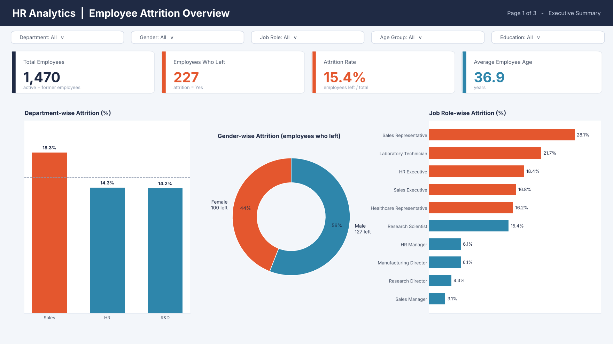

# HR Analytics – Employee Attrition Prediction (Python + Power BI)

End-to-end analytics project: clean HR data → explore attrition drivers → predict who is likely to leave → visualise in Power BI.



## Headline results
| Metric | Value |
|---|---|
| Employees analysed | 1,470 (227 left → **15.4 % attrition**) |
| Biggest driver | **Overtime**: 26.0 % attrition vs 11.3 % without (2.3×) |
| Highest-risk groups | Age 18-25 (34 %), pay < 6K/month (35-38 %), Sales Representatives (28 %), Lab Technicians (22 %) |
| Best model | Random Forest – test ROC-AUC **0.81**, accuracy 0.80, precision 0.39, recall 0.56, F1 0.46 |
| Risk tiers (out-of-fold) | Actual attrition: Low 5.8 % · Medium 21.7 % · **High 45.4 %** |

## Tech stack
Python · Pandas · NumPy · Matplotlib · Seaborn · Scikit-learn · Jupyter · Power BI (DAX)

## Project structure
```
HR_Attrition_Project/
├── data/
│   ├── raw/HR_Employee_Attrition.csv          # raw data (with injected missing values/duplicates)
│   └── processed/
│       ├── cleaned_hr_data.csv                # cleaned + engineered features
│       └── attrition_predictions.csv          # ← load this into Power BI
├── notebooks/
│   ├── 01_Data_Cleaning_and_EDA.ipynb
│   └── 02_Attrition_Prediction_Model.ipynb
├── src/
│   ├── generate_dataset.py   data_cleaning.py   eda.py   model_training.py
│   ├── run_pipeline.py       # one command rebuilds everything
│   ├── build_notebooks.py    make_dashboard_preview.py
├── models/attrition_model.joblib
├── images/eda/  images/model/                 # all charts (PNG)
├── reports/model_metrics.csv  model_summary.json  HR_Attrition_Final_Report.docx
└── powerbi/
    ├── PowerBI_Dashboard_Guide.md   DAX_Measures.dax   HR_Analytics_Theme.json
    └── preview/dashboard_page{1,2,3}_preview.png
```

## Quick start
```bash
pip install -r requirements.txt
python src/run_pipeline.py        # clean → EDA charts → train → export predictions
jupyter notebook notebooks/       # walk through the analysis
```
Then open Power BI Desktop and follow `powerbi/PowerBI_Dashboard_Guide.md`.

## Method summary
1. **Cleaning** – removed 20 duplicates, standardised text, dropped 3 constant columns, imputed 68 missing cells (income by job level, experience by age band), repaired illogical values, engineered age/salary/experience bands and readable labels.
2. **EDA** – attrition by age, gender, department, job role, salary, satisfaction, overtime, experience, education; correlations; overtime × satisfaction interaction.
3. **Modelling** – stratified 80/20 split; one-hot encoding; scaling only for Logistic Regression; class-weight balancing for the 15 % minority class; 5-fold grid search (F1) on train only; model chosen on CV score (not test); F1-optimal threshold chosen on out-of-fold train predictions.
4. **Predictions** – every employee scored with 5-fold **out-of-fold** probabilities (no memorisation), banded into Low/Medium/High risk.
5. **Power BI** – 3-page dashboard (Overview, Drivers, Predictions), 12 required visuals, 5 synced slicers.

## Important notes (read before presenting)
- **The dataset is synthetic.** It mirrors the IBM HR Analytics structure with realistic, research-based attrition drivers so the project runs offline. Findings describe *this* dataset and must not be quoted as real-world statistics. Swap in a real export (same column names) and re-run `run_pipeline.py`.
- Because the drivers were built into the simulation, the model recovering them shows the pipeline works; it does not prove those effects in your organisation.
- Model precision is moderate (~4 in 10 flagged employees leave). Use scores as an **early-warning list for supportive retention conversations**, never for punitive decisions.
- Test set = 294 employees (~45 leavers), so metrics carry meaningful uncertainty (± several points).
- The `.pbix` must be built in Power BI Desktop (guide + DAX + theme provided); previews are design renders from the real data.

## Resume bullets
- Built an end-to-end HR attrition analytics solution (Python, scikit-learn, Power BI) on 1,470 employees; Random Forest achieved ROC-AUC 0.81 and isolated a High-risk tier with 8× the attrition of the Low tier (45 % vs 6 %).
- Identified overtime, low pay, early-career tenure and role as principal attrition drivers; designed a 3-page interactive Power BI dashboard with 30+ DAX measures and synced slicers.
